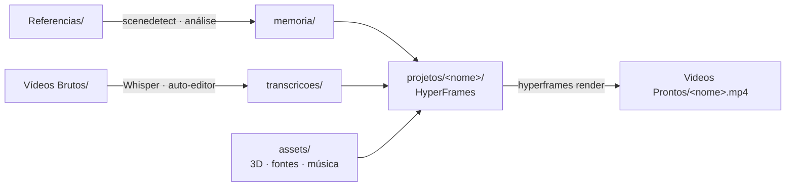

# Editor de Vídeo

> Estúdio de edição de vídeo operado pelo Claude Code: você entrega referências e material bruto, ele monta, anima e renderiza o vídeo pronto com HyperFrames e FFmpeg.

   

## Sumário

- [Sobre](#sobre) · [Funcionalidades](#funcionalidades) · [Arquitetura](#arquitetura) · [Requisitos](#requisitos)
- [Instalação](#instalação) · [Uso](#uso) · [Configuração](#configuração) · [Estrutura do projeto](#estrutura-do-projeto)
- [Solução de problemas](#solução-de-problemas) · [Licença](#licença)

## Sobre

Este repositório é um ambiente de trabalho para o Claude Code produzir vídeos (principalmente
vídeos comerciais dos projetos do Laboratório LAOB). Cada vídeo é um projeto HyperFrames: HTML, CSS
e JavaScript animados, sincronizados com narração e trilha, renderizados para MP4. As preferências
de estilo e o histórico ficam versionados em `memoria/`, então o trabalho continua igual em
qualquer máquina.

## Funcionalidades

- Analisa vídeos de referência (cortes, ritmo, legendas, paleta) e registra o estilo.
- Transcreve o material bruto com Whisper e remove silêncios com auto-editor.
- Monta o vídeo em HyperFrames: tipografia cinética, legendas, transições, 3D com Three.js.
- Gera narração em português (edge-tts, voz `pt-BR-AntonioNeural`) e escolhe trilha e efeitos.
- Converte modelos CAD (STEP) em 3D leve para usar nas animações.
- Guarda preferências, histórico e análises de referência em `memoria/`.

## Arquitetura



**Fluxo de trabalho**

1. **Referência:** baixar para `Referencias/`, analisar e registrar em `memoria/referencias.md`.
2. **Brutos:** transcrever, cortar silêncios e erros, escolher os melhores trechos.
3. **Montagem:** criar `projetos/<nome>/` com legendas, títulos, zooms, b-roll e música.
4. **Revisão:** `hyperframes snapshot` / `preview` antes de renderizar.
5. **Render:** salvar em `Videos Prontos/<nome>.mp4`.
6. **Memória:** atualizar `memoria/` e enviar ao GitHub.

## Requisitos

- Linux ou macOS.
- Node.js 22 (via nvm), FFmpeg, [uv](https://docs.astral.sh/uv/).
- Ferramentas instaladas pelo `setup.sh`: HyperFrames, yt-dlp, whisper-ctranslate2, auto-editor, scenedetect, edge-tts.
- Claude Code (o estúdio é operado por ele, seguindo o [`CLAUDE.md`](CLAUDE.md)).

## Instalação

1. Clone o repositório:

   ```bash
   git clone https://github.com/VituColombo0/editor-de-video.git
   ```

2. Instale as ferramentas:

   ```bash
   cd editor-de-video && bash scripts/setup.sh
   ```

3. Confira se está tudo certo:

   ```bash
   hyperframes doctor
   ```

## Uso

Abra o Claude Code na pasta do repositório e peça o vídeo, por exemplo: *"faça um Reels de 40 s do
Scanner LAOB no estilo desta referência"*. Coloque o material em `Vídeos Brutos/` e as referências
em `Referencias/`.

Dentro de um projeto (ex.: `projetos/scanner-laob-v7`):

| Comando | O que faz |
| :--- | :--- |
| `npm run dev` | Pré-visualiza no navegador |
| `npm run check` | Verifica a composição |
| `npm run render` | Renderiza o MP4 |

Comandos úteis:

```bash
whisper-ctranslate2 bruto.mp4 --model small --language pt --output_format srt --output_dir transcricoes/ --compute_type int8
```

```bash
auto-editor bruto.mp4 --margin 0.2s
```

```bash
edge-tts --voice pt-BR-AntonioNeural --rate=-2% --pitch=+6Hz --text "Texto da narração" --write-media fala.mp3
```

**Converter CAD para o vídeo** (detalhes em [scripts/cad/LEIAME.md](scripts/cad/LEIAME.md)):
`step_para_glb.py` → `reduzir_malha.py` → `glb_para_js.py`.

## Configuração

| Arquivo | Conteúdo |
| :--- | :--- |
| [`memoria/preferencias.md`](memoria/preferencias.md) | Estilo aprovado: ritmo, cortes, legendas, voz, formatos |
| [`memoria/historico.md`](memoria/historico.md) | Uma linha por vídeo feito |
| [`memoria/referencias.md`](memoria/referencias.md) | Análise de cada referência |
| [`CLAUDE.md`](CLAUDE.md) | Instruções de operação para o Claude |

## Estrutura do projeto

```text
editor-de-video/
├── Vídeos Brutos/      # material gravado (fora do Git)
├── Referencias/        # vídeos de referência (fora do Git)
├── Videos Prontos/     # vídeos finais (fora do Git)
├── projetos/           # um projeto HyperFrames por vídeo
├── transcricoes/       # legendas e transcrições
├── assets/             # 3D, fontes, logos, músicas
├── memoria/            # preferências, histórico, referências
└── scripts/            # setup.sh e conversão de CAD
```

## Solução de problemas

| Sintoma | Causa provável | Correção |
| :--- | :--- | :--- |
| Render trava ou é morto | Pouca memória RAM | Renderize com menos workers, feche outros apps ou divida em partes e junte com FFmpeg |
| `hyperframes` falha ao iniciar | Node diferente do 22 | `nvm use 22` |
| `ffmpeg` para em laço de shell | Lê o stdin | Use `ffmpeg -nostdin` |

## Equipe

Desenvolvido por Victor Colombo, para os vídeos do Laboratório LAOB.

## Licença

Uso interno — todos os direitos reservados.
